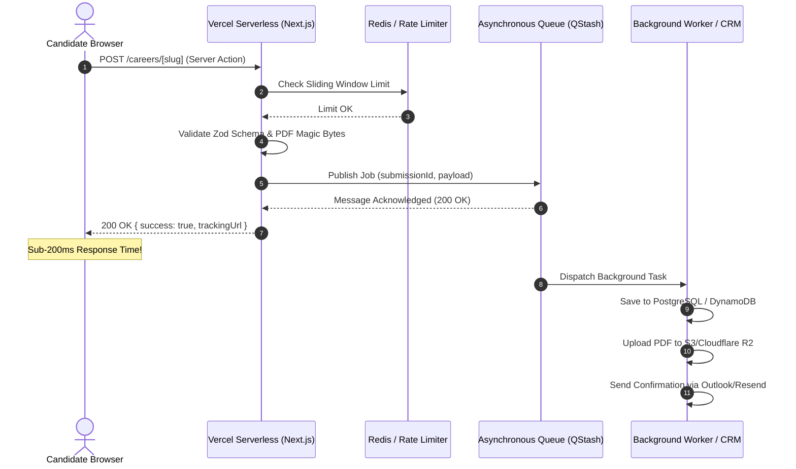

# Cynbit Technologies — Backend Technical Audit & Architectural Review

**Candidate:** Sumit Kesarwani  
**Role:** Backend Developer Intern  
**Date:** October 30, 2026  
**Target Application:** [https://www.cynbit.in/](https://www.cynbit.in/) & [https://portal.cynbit.in/](https://portal.cynbit.in/)  
**Assessment Policy Compliance:** Non-intrusive, authorized passive observation only. No disruptive testing, fuzzing, or unauthorized exploitation performed.

---

## Executive Summary

A comprehensive architectural and technical evaluation was conducted on Cynbit's public-facing digital ecosystem. The system leverages modern web engineering practices—notably **Next.js (App Router)** hosted on **Vercel's Edge/Serverless platform**, utilizing **React Server Actions** for handling transactional operations (inquiries, job applications, and portal access).

While the application achieves fast global delivery through edge caching and static prerendering, observable backend configurations reveal critical opportunities for hardening:
1. **Security & Authentication:** Global wildcard CORS policies, absence of foundational HTTP security headers (`CSP`, `X-Frame-Options`), exposure of internal routing/technology fingerprints, and single-factor pre-shared key authentication on `portal.cynbit.in`.
2. **Data Ingestion & Integrity:** Hybrid serialization patterns (`JSON.stringify` inside `FormData`) on recruitment pipelines without visible rate limiting or cryptographic anti-abuse controls.
3. **System Resiliency & Performance:** Synchronous processing of external integrations (email dispatch, applicant storage) within serverless boundaries without async message queuing.
4. **Domain Reputation & Email Security:** Mismatched SPF configuration between DNS records and Microsoft 365 MX exchange, paired with an unenforced DMARC policy (`p=none`).

This report provides detailed architectural breakdowns, risk matrices, and production-ready TypeScript/Next.js code implementations to remediate these issues.

---

## 1. Backend Technical Audit Report

### 1.1 Infrastructure & Observability Topology

| Layer | Observable Implementation | Observations & Implications |
| :--- | :--- | :--- |
| **Edge & CDN** | Vercel Edge Network (`Server: Vercel`) | POP routing identified at Mumbai (`bom1`) and fallback execution in US East (`iad1`). |
| **Framework Runtime** | Next.js App Router (React Server Components) | `X-Nextjs-Prerender: 1`, `X-Nextjs-Stale-Time: 300`, `Vary: rsc, next-router-state-tree`. Exposes framework version patterns. |
| **DNS & Routing** | GoDaddy Nameservers (`ns33.domaincontrol.com`) pointing to Vercel CNAME/A (`216.198.79.1`) | Subdomain split: Main marketing application at `cynbit.in`, administrative dashboard at `portal.cynbit.in`. |
| **Email Gateway** | Microsoft 365 Exchange (`cynbit-in.mail.protection.outlook.com`) | Transactional and corporate mail routing. |

```
                       [ Public Client / Browser ]
                                   │
                                   ▼
                       [ Vercel Edge Network (Anycast) ]
                                   │
              ┌────────────────────┴────────────────────┐
              ▼                                         ▼
      [ cynbit.in (Main Site) ]                [ portal.cynbit.in ]
      • Edge HTML Caching                      • Internal Admin Auth
      • Static RSC Bundles                     • Security Key Verification
      • Server Actions:                        • Server Action:
        - submitInquiry                          - loginToPortal
        - submitCandidateApplication           • Session: localStorage tracker
```

### 1.2 API Structure & Payload Analysis

Cynbit departs from standard RESTful JSON APIs (`/api/*`) in favor of **Next.js Server Actions (RPC over HTTP POST)**. Server actions are bound to cryptographisc compilation hashes and triggered via POST requests with the `Next-Action` header:

#### 1. Contact Inquiry Pipeline (`submitInquiry`)
* **Server Action Identifier:** `40247ba4465344b3386595bab4303317cdcce907df`
* **Trigger Endpoint:** `POST /contact`
* **Wire Protocol:** `multipart/form-data`
* **Payload Fields:**
  * `fullName` (String, required)
  * `email` (String, email format, required)
  * `company` (String, optional)
  * `industry` (String, optional)
  * `message` (String, required)
* **Response Contract:**
  ```json
  {
    "success": true
  }
  // Error state:
  {
    "success": false,
    "error": "Something went wrong. Please try again or email us directly."
  }
  ```

#### 2. Recruitment Application Pipeline (`submitCandidateApplication`)
* **Server Action Identifier:** `40645a00e04f6854903cf3a65fda4c75ddd7691de9`
* **Trigger Endpoint:** `POST /careers/[slug]`
* **Payload Structure:**
  * **Flat Metadata:** `jobId`, `fullName`, `email`, `phone`, `linkedinUrl`, `professionalProfileUrl`, `message`, `agreedToTerms`.
  * **Serialized Complex Data:** `educationData` is transmitted as an embedded JSON string (`JSON.stringify(array)`) alongside derived flat summary fields (`education`, `university`, `graduationYear`).
  * **Binary Attachment:** `resume` (Multipart file stream).
* **Observed Client Response Contract:**
  ```typescript
  interface CandidateSubmissionResult {
    success: boolean;
    isDuplicate?: boolean;
    trackingUrl?: string;
    error?: string;
  }
  ```
* **Architectural Observation:** Passing raw JSON within `FormData` creates a dual-deserialization burden on the server. If the server action unpacks `educationData` without schema validation, malformed payloads can trigger unhandled edge crashes. Furthermore, returning `trackingUrl` indicates database persistence and unique index checks occur synchronously during the request cycle.

#### 3. Administrative Portal Authentication (`loginToPortal`)
* **Server Action Identifier:** `40d93da1cc26de4ef37bcb273184b7141ef77a50f8`
* **Trigger Endpoint:** `POST /portal`
* **Payload:** `password` (String)
* **Client Behavior:** Upon success, stores timestamp in `localStorage.setItem("cynbit_portal_last_activity", Date.now().toString())` and redirects to `/dashboard`.
* **Redirect Behavior:** Direct unauthenticated access to `https://portal.cynbit.in/dashboard` triggers a `307 Temporary Redirect` back to `/`.

---

## 2. Security & Performance Findings

### 2.1 Security & Authentication Vulnerabilities

```
┌────────────────────────────────┬──────────┬─────────────────────────────┬───────────────────────────┐
│ Finding                        │ Severity │ Affected Surface            │ Impact                    │
├────────────────────────────────┼──────────┼─────────────────────────────┼───────────────────────────┤
│ Single-Factor Shared Secret    │ HIGH     │ portal.cynbit.in            │ Unauthorized access, zero │
│ (Pre-shared "Security Key")    │          │ (loginToPortal)             │ auditability, no RBAC     │
├────────────────────────────────┼──────────┼─────────────────────────────┼───────────────────────────┤
│ Missing Security Headers       │ MEDIUM   │ Global (cynbit.in & portal) │ Clickjacking, XSS, MIME-  │
│ (CSP, X-Frame-Options, etc.)   │          │                             │ sniffing vulnerability    │
├────────────────────────────────┼──────────┼─────────────────────────────┼───────────────────────────┤
│ Wildcard CORS on Document      │ MEDIUM   │ Global response headers     │ Unintended cross-origin   │
│ (Access-Control-Allow-Origin:*)│          │ (cynbit.in)                 │ resource exposure         │
├────────────────────────────────┼──────────┼─────────────────────────────┼───────────────────────────┤
│ Framework Information Leakage  │ LOW      │ Dynamic routes              │ Fingerprinting & attack   │
│ (X-Powered-By, X-Matched-Path) │          │ (/dashboard, /contact)      │ surface reconnaissance    │
├────────────────────────────────┼──────────┼─────────────────────────────┼───────────────────────────┤
│ Incomplete SPF & Permissive    │ MEDIUM   │ DNS / Outbound Email        │ Spoofing risks & reduced  │
│ DMARC Configuration            │          │ (cynbit.in)                 │ email deliverability      │
└────────────────────────────────┴──────────┴─────────────────────────────┴───────────────────────────┘
```

#### Detailed Breakdown:

1. **Shared Pre-Shared Key (PSK) on Internal Portal:**
   * **Root Cause:** The portal login does not verify unique user identities (email + password + MFA) but checks a single static security key.
   * **Impact:** No non-repudiation (impossible to tell *who* performed an action). If one team member or contractor leaks the key, the entire admin surface is compromised. Revoking access requires rotating the master key across all staff.
   * **Session State in LocalStorage:** Storing `cynbit_portal_last_activity` in `localStorage` relies on client-side state for idle session tracking. Any script or malicious browser extension can tamper with this value.

2. **Absence of Hardened HTTP Defense Headers:**
   * **Missing `Content-Security-Policy`:** No restriction on where scripts, styles, frames, or image sources can be fetched from.
   * **Missing `X-Frame-Options` or `frame-ancestors`:** Cynbit's portal and marketing pages can be framed within an external site, creating a vector for clickjacking or credential harvesting.
   * **Missing `X-Content-Type-Options: nosniff`:** Browsers may inspect content and execute files based on detected content rather than declared MIME types.

3. **Email Authentication Mismatch:**
   * Public DNS TXT indicates: `v=spf1 include:secureserver.net -all`.
   * Public MX record indicates: `cynbit-in.mail.protection.outlook.com`.
   * **The Gap:** The SPF record does *not* authorize Microsoft 365 (`include:spf.protection.outlook.com`). Outbound notification emails dispatched to candidates or clients from Cynbit's Exchange accounts will trigger SPF authentication failures or be routed to spam folders. Furthermore, `_dmarc.cynbit.in` is set to `p=none;`, allowing unauthenticated spoofing without MTA rejection.

---

### 2.2 Data Handling & Validation Observations

1. **Client-Serialized Nested Payloads (`educationData`):**
   * Transmission of complex nested arrays via stringified JSON inside `FormData` bypasses native form validation.
   * **Backend Risk:** The receiving serverless function must invoke `JSON.parse()`. Without a robust schema validation layer (such as Zod), invalid JSON syntax or unanticipated object structures cause unhandled runtime exceptions (`500 Internal Server Error`).

2. **Resume Attachment Processing:**
   * The candidate portal accepts file attachments.
   * **Backend Best Practice Requirements:**
     * File signatures (magic bytes) must be verified on the server side (rather than relying on client-supplied `file.type`).
     * Executable extensions (`.exe`, `.sh`, `.php`, `.svg` with embedded scripts) must be rejected.
     * Uploaded blobs should not be buffered in serverless function memory or written to disk; they should be piped directly to an isolated object storage bucket (e.g. AWS S3 / Cloudflare R2) with strict read-only presigned URLs.

---

### 2.3 Performance & Architecture Opportunities

1. **Synchronous Serverless Bottlenecks:**
   * During candidate or inquiry submission, the serverless handler performs:
     1. Data parsing & duplicate checking.
     2. Database insertion (applications table).
     3. External SMTP/Email API calls (sending confirmation emails).
     4. Slack/Webhook notifications to internal recruiters.
   * **Risk:** External email and webhook latency spikes directly increase HTTP response time (often exceeding 2–4 seconds) and expose serverless invocations to timeout limits.
   * **Optimization:** Ingest the submission immediately, store to an event queue (e.g. Upstash Redis / QStash / AWS SQS), and return an instant `202 Accepted` response. Let asynchronous background workers handle email dispatches and indexing.

2. **Missing Rate Limiting & Bot Prevention:**
   * The recruitment and contact actions have no distributed rate-limiting or anti-abuse protection (such as sliding-window rate limiters or Turnstile challenges).
   * **Risk:** Susceptible to programmatic spam, resource exhaustion, and recruitment database pollution.

---

## 3. Recommended Improvements & Architectural Code Solutions

Below are production-grade implementations designed for Cynbit's Next.js / Vercel architecture.

---

### 3.1 Hardened Security Middleware & HTTP Headers

Configure `next.config.js` to strip framework identification headers and apply comprehensive security headers:

```javascript
// next.config.js
/** @type {import('next').NextConfig} */
const nextConfig = {
  // 1. Disable framework identification
  poweredByHeader: false,
  
  // 2. Strict CORS & Security Headers
  async headers() {
    return [
      {
        source: '/:path*',
        headers: [
          {
            key: 'X-DNS-Prefetch-Control',
            value: 'on',
          },
          {
            key: 'Strict-Transport-Security',
            value: 'max-age=63072000; includeSubDomains; preload',
          },
          {
            key: 'X-Frame-Options',
            value: 'DENY',
          },
          {
            key: 'X-Content-Type-Options',
            value: 'nosniff',
          },
          {
            key: 'Referrer-Policy',
            value: 'strict-origin-when-cross-origin',
          },
          {
            key: 'Permissions-Policy',
            value: 'camera=(), microphone=(), geolocation=(), browsing-topics=()',
          },
          {
            key: 'Content-Security-Policy',
            value: [
              "default-src 'self'",
              "script-src 'self' 'unsafe-eval' 'unsafe-inline' https://www.googletagmanager.com",
              "style-src 'self' 'unsafe-inline' https://fonts.googleapis.com",
              "font-src 'self' https://fonts.gstatic.com data:",
              "img-src 'self' https: data: blob:",
              "connect-src 'self' https://*.cynbit.in https://www.google-analytics.com",
              "frame-ancestors 'none'",
              "base-uri 'self'",
              "form-action 'self'",
            ].join('; '),
          },
        ],
      },
    ];
  },
};

module.exports = nextConfig;
```

---

### 3.2 Robust Zod Validation & Type-Safe Server Action

Refactor `submitCandidateApplication` using strict Zod schema validation, defensive JSON parsing, and sanitized error outputs:

```typescript
// app/actions/candidate.ts
'use server';

import { z } from 'zod';
import { sanitizeHtml } from '@/lib/sanitize';
import { enqueueApplicationProcessing } from '@/lib/queue';
import { rateLimiter } from '@/lib/rate-limiter';
import { headers } from 'next/headers';

// 1. Strict Nested Schema Definitions
const EducationEntrySchema = z.object({
  id: z.string(),
  qualificationLevel: z.string().min(1, 'Qualification level is required'),
  degree: z.string().min(1, 'Degree is required'),
  customDegree: z.string().optional(),
  specialization: z.string().optional(),
  university: z.string().min(2, 'University must be at least 2 characters'),
  graduationYear: z.string().regex(/^\d{4}$/, 'Invalid graduation year'),
  scoreType: z.enum(['CGPA', 'Percentage']).default('CGPA'),
  scoreValue: z.string().optional(),
  status: z.enum(['Completed', 'Currently Pursuing', 'Expected to Graduate']),
});

const ApplicationInputSchema = z.object({
  jobId: z.string().min(1, 'Job ID is required'),
  fullName: z.string().trim().min(2).max(100),
  email: z.string().trim().email('Invalid email address').toLowerCase(),
  phone: z.string().regex(/^\+?[1-9]\d{7,14}$/, 'Invalid international phone number'),
  linkedinUrl: z.string().url('Invalid LinkedIn URL').regex(/linkedin\.com/, 'Must be a LinkedIn profile'),
  professionalProfileUrl: z.string().url().optional().or(z.literal('')),
  message: z.string().min(10, 'Message must be at least 10 characters').max(3000),
  agreedToTerms: z.literal(true, {
    errorMap: () => ({ message: 'You must agree to the Terms & Conditions' }),
  }),
  educationData: z.string().transform((str, ctx) => {
    try {
      const parsed = JSON.parse(str);
      return z.array(EducationEntrySchema).min(1).parse(parsed);
    } catch {
      ctx.addIssue({
        code: z.ZodIssueCode.custom,
        message: 'Invalid education data structure',
      });
      return z.NEVER;
    }
  }),
});

export type ActionResponse = {
  success: boolean;
  trackingUrl?: string;
  isDuplicate?: boolean;
  error?: string;
};

export async function submitCandidateApplication(
  formData: FormData
): Promise<ActionResponse> {
  try {
    // 2. IP-based Rate Limiting
    const headerList = await headers();
    const clientIp = headerList.get('x-forwarded-for')?.split(',')[0].trim() || '127.0.0.1';
    
    const { success: allowed } = await rateLimiter.limit(`application:${clientIp}`);
    if (!allowed) {
      return {
        success: false,
        error: 'Too many requests. Please wait a few moments before trying again.',
      };
    }

    // 3. Raw Payload Extraction & Validation
    const rawData = {
      jobId: formData.get('jobId'),
      fullName: formData.get('fullName'),
      email: formData.get('email'),
      phone: formData.get('phone'),
      linkedinUrl: formData.get('linkedinUrl'),
      professionalProfileUrl: formData.get('professionalProfileUrl'),
      message: formData.get('message'),
      agreedToTerms: formData.get('agreedToTerms') === 'on' || formData.get('agreedToTerms') === 'true',
      educationData: formData.get('educationData'),
    };

    const validatedData = ApplicationInputSchema.parse(rawData);

    // 4. Secure File Validation (Magic Bytes Check)
    const file = formData.get('resume') as File | null;
    if (!file || file.size === 0) {
      return { success: false, error: 'Resume file is required.' };
    }

    const MAX_SIZE_BYTES = 5 * 1024 * 1024; // 5 MB
    if (file.size > MAX_SIZE_BYTES) {
      return { success: false, error: 'Resume must be smaller than 5MB.' };
    }

    // Inspect first 4 bytes for PDF magic number (%PDF -> 0x25 0x50 0x44 0x46)
    const buffer = Buffer.from(await file.arrayBuffer());
    const isPdf = buffer[0] === 0x25 && buffer[1] === 0x50 && buffer[2] === 0x44 && buffer[3] === 0x46;
    if (!isPdf) {
      return { success: false, error: 'Only authentic PDF documents are accepted.' };
    }

    // 5. Asynchronous Job Enqueueing (Decoupled Resilient Pipeline)
    const submissionId = crypto.randomUUID();
    await enqueueApplicationProcessing({
      submissionId,
      candidate: validatedData,
      resumeBuffer: buffer,
      fileName: file.name,
      receivedAt: new Date().toISOString(),
    });

    return {
      success: true,
      trackingUrl: `/portal/track/${submissionId}`,
    };
  } catch (error) {
    if (error instanceof z.ZodError) {
      return {
        success: false,
        error: error.issues.map((issue) => issue.message).join('. '),
      };
    }

    // Defensive logging (avoid exposing internal database stack traces)
    console.error('[Application_Submission_Error]:', error);
    return {
      success: false,
      error: 'An unexpected error occurred while processing your blueprint. Please contact us directly.',
    };
  }
}
```

---

### 3.3 Asynchronous Queue Pattern (Decoupling Background Jobs)

Prevent serverless timeouts by deferring email and third-party CRM synchronization using an edge-compatible message queue (e.g., Upstash QStash or Redis Queue):

```typescript
// lib/queue.ts
import { Client } from '@upstash/qstash';

const qstash = new Client({
  token: process.env.QSTASH_TOKEN!,
});

export async function enqueueApplicationProcessing(payload: {
  submissionId: string;
  candidate: any;
  resumeBuffer: Buffer;
  fileName: string;
  receivedAt: string;
}) {
  // Dispatches an asynchronous HTTP webhook to internal background worker
  await qstash.publishJSON({
    url: `${process.env.INTERNAL_WORKER_URL}/api/webhooks/process-application`,
    body: {
      submissionId: payload.submissionId,
      candidate: payload.candidate,
      resumeBase64: payload.resumeBuffer.toString('base64'),
      fileName: payload.fileName,
      timestamp: payload.receivedAt,
    },
    retries: 3, // Built-in exponential backoff
  });
}
```



---

### 3.4 Modern Authentication & Role-Based Access Control (RBAC)

Replace the single static security key on `portal.cynbit.in` with encrypted, HTTP-only cookie sessions using iron-session or Lucia Auth:

```typescript
// lib/auth/session.ts
import { getIronSession, SessionOptions } from 'iron-session';
import { cookies } from 'next/headers';

export interface SessionData {
  userId: string;
  email: string;
  role: 'superadmin' | 'architect' | 'reviewer';
  isLoggedIn: boolean;
  expiresAt: number;
}

export const sessionOptions: SessionOptions = {
  password: process.env.SECRET_COOKIE_PASSWORD as string, // 32+ character key
  cookieName: 'cynbit_session',
  cookieOptions: {
    secure: process.env.NODE_ENV === 'production',
    httpOnly: true, // Immune to XSS / JavaScript theft
    sameSite: 'strict', // Immune to CSRF
    path: '/',
    maxAge: 60 * 60 * 8, // 8-hour session expiration
  },
};

export async function getSession() {
  const cookieStore = await cookies();
  return getIronSession<SessionData>(cookieStore, sessionOptions);
}
```

```typescript
// middleware.ts (Protecting /portal & /dashboard routes)
import { NextResponse } from 'next/server';
import type { NextRequest } from 'next/request';
import { getIronSession } from 'iron-session';
import { sessionOptions, SessionData } from '@/lib/auth/session';

export async function middleware(request: NextRequest) {
  const res = NextResponse.next();
  const session = await getIronSession<SessionData>(request.cookies, res.cookies, sessionOptions);

  const isPortalRoute = request.nextUrl.pathname.startsWith('/dashboard') || 
                        request.nextUrl.pathname.startsWith('/portal/admin');

  if (isPortalRoute) {
    if (!session.isLoggedIn || Date.now() > session.expiresAt) {
      session.destroy();
      const loginUrl = new URL('/portal', request.url);
      loginUrl.searchParams.set('redirect', request.nextUrl.pathname);
      return NextResponse.redirect(loginUrl);
    }
  }

  return res;
}

export const config = {
  matcher: ['/dashboard/:path*', '/portal/admin/:path*'],
};
```

---

### 3.5 DNS & Email Deliverability Fixes

To prevent Cynbit's transactional emails from landing in applicant spam folders and safeguard the domain from impersonation, update DNS records with the domain registrar:

1. **Update SPF Record:**
   * **Current:** `v=spf1 include:secureserver.net -all`
   * **Remediated:** 
     ```text
     v=spf1 include:secureserver.net include:spf.protection.outlook.com -all
     ```
     *(Authorizes both GoDaddy web forwarding and Cynbit's active Microsoft 365 Exchange tenant).*

2. **Enforce DMARC Policy:**
   * **Current:** `v=DMARC1; p=none;`
   * **Remediated (Phased Enforcement):**
     ```text
     v=DMARC1; p=quarantine; rua=mailto:dmarc-reports@cynbit.in; ruf=mailto:dmarc-failures@cynbit.in; pct=100; sp=quarantine;
     ```
     *(Quarantines illegitimate spoofed emails and reports telemetry directly to Cynbit's engineering mailbox).*

---

## 4. Summary & Implementation Roadmap

| Priority | Initiative | Estimated Effort | Impact |
| :--- | :--- | :--- | :--- |
| **P0 (Immediate)** | Add Microsoft 365 to SPF record & update DMARC | 1 hour | Fixes email deliverability and stops domain spoofing. |
| **P0 (Immediate)** | Add security headers (`CSP`, `X-Frame-Options`, `nosniff`) & remove `poweredByHeader` | 2 hours | Mitigates clickjacking, XSS, and reconnaissance. |
| **P1 (High)** | Replace shared Security Key with RBAC & `HttpOnly` sessions on `portal.cynbit.in` | 1–2 days | Solves non-repudiation and secures internal dashboards. |
| **P1 (High)** | Deep Zod validation & PDF magic-byte checks on Server Actions | 1 day | Hardens application against malformed payloads and DoS. |
| **P2 (Medium)** | Decouple email/recruitment pipeline with async queue (QStash / SQS) | 2 days | Guarantees sub-200ms latency and eliminates serverless timeout risk. |

---

*Report prepared for Aria & the Cynbit Engineering Team.*

